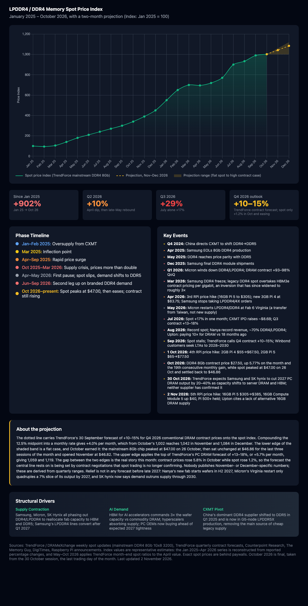

# LPDDR4 / DDR4 Memory Spot Price Index

An interactive chart tracking the rise in LPDDR4 and DDR4 memory prices from January 2025 through October 2026, with a dotted two-month projection for November and December 2026.

## The Story

Memory prices are up roughly **+902%** since January 2025, driven by three things at once:

- **AI demand** — HBM for AI accelerators now commands 3× the wafer capacity vs commodity DRAM, and PC OEMs are buying ahead of expected 2027 tightness
- **Supply contraction** — Samsung, Micron, and SK Hynix are phasing out DDR4/LPDDR4 to focus on HBM and DDR5; Samsung stopped accepting LPDDR4/4X orders in April 2026
- **CXMT pivot** — China's dominant DDR4 supplier shifted to DDR5 production in Q1 2025 and is now on its G5 node making LPDDR5X

The impact is visible in products like the Raspberry Pi 5, which has now seen five price rises in a year. The 16GB model went from $120 to $205 in February 2026, to $305 in April, and to $385 on 2 November. Raspberry Pi introduced a 3GB Pi 4 at $83.75 in April because two 1.5GB LPDDR4 chips were cheaper to source than one 4GB part, and on 1 October 2026 it raised the 2GB Pi 4 and Pi 5, which it had held at $55 and $65, to $67.50 and $77.50. Eben Upton told CNBC in August that the company is paying ten times more for DRAM than eighteen months earlier; announcing the November rise he blamed a lack of alternative supply for 16GB DRAM, and said he expects to roll the increases back when memory costs fall.

After a pause in April and May 2026, spot prices climbed again from June through September — July alone was +17% — before stalling at record levels in mid-September. October broke that plateau only briefly. The mainstream 8Gb chip reached a record $47.00 on 26 October, then gave the gain back, closing the month at $46.86 and opening November at $46.82, for a monthly rise of just 1.2%. Contract prices went the other way: the general-purpose DDR4 8Gb chip settled at $27.50, up 5.8% on the month and the nineteenth consecutive monthly increase. Spot and contract have decoupled, because the buyers who can still get allocation are paying for it while spot traders sit out a market TrendForce's own daily commentary now calls sluggish.

TrendForce's 30 September outlook still calls for Q4 2026 conventional DRAM contract prices to rise another 10–15%, and nobody forecasts relief before late 2027: Nanya's new fab starts wafers in H2 2027, Micron's Virginia DDR4/LPDDR4 restart is a transfer from Taiwan rather than net new capacity, and SK hynix now expects demand to outrun supply through 2030. TrendForce also expects Samsung and SK hynix to cut PC DRAM output by 20–40% in 2027 as capacity moves to server DRAM and HBM, though neither supplier has confirmed it.

## Key Dates

| Date | Event |
|------|-------|
| Q4 2024 | China directs CXMT to shift DDR4→DDR5 |
| Mar 2025 | Inflection point — prices begin rising |
| Apr 2025 | Samsung EOLs 8Gb DDR4 production |
| May 2025 | DDR4 reaches price parity with DDR5 |
| Dec 2025 | Samsung final DDR4 module shipments |
| Q1 2026 | Micron winds down DDR4/LPDDR4; DRAM contract +93–98% QoQ |
| Mar 2026 | Samsung DDR4 freeze; legacy DDR4 spot overtakes HBM3e contract pricing per gigabit |
| Apr 2026 | 3rd RPi price hike (16GB Pi 5 to $305); new 3GB Pi 4 at $83.75; Samsung stops taking LPDDR4 orders |
| May 2026 | Micron restarts LPDDR4/DDR4 at Fab 6, Virginia |
| Jul 2026 | Spot +17% in a month; CXMT IPO; Q3 contract +13–18% |
| Aug 2026 | Record spot; Nanya record revenue; Upton: DRAM cost 10× in 18 months |
| Sep 2026 | Spot plateaus; TrendForce calls Q4 contract +10–15% |
| 1 Oct 2026 | 4th RPi price hike: 2GB Pi 4 $67.50, 2GB Pi 5 $77.50 |
| Oct 2026 | DDR4 8Gb contract $27.50, +5.8% and a 19th straight monthly gain; spot peaks at $47.00 then settles at $46.86 |
| 30 Oct 2026 | TrendForce expects Samsung and SK hynix to cut 2027 PC DRAM output 20–40%; unconfirmed by either |
| 2 Nov 2026 | 5th RPi price hike: 16GB Pi 5 $305→$385, 16GB CM5 up $40, Pi 500+ held |

## The projection

The dotted line compounds the midpoint of TrendForce's +10–15% Q4 conventional DRAM contract forecast into a monthly rate of +4.0% and applies it from October's 1,002, giving 1,042 in November and 1,084 in December. The shaded band runs from a flat case, which October's own trading earns — a record on 26 October, then three unchanged sessions to close the month and a slightly lower open in November — up to the top of TrendForce's PC DRAM forecast of +13–18%, or +5.7% a month, reaching 1,119. The band is wider in meaning than usual this month: the central line follows contract prices that are still climbing at nearly 6% a month, while the spot series the index actually measures has gone flat. No source publishes month-specific numbers for November or December; the band is there to make that uncertainty visible rather than to hide it.

## View the Chart

**Option 1:** [View live version](https://nthanksforallthefish.github.io/Raspberry-Pi-Prices/)

**Option 2:** Download `index.html` and open it in any browser

## Data Sources

- [TrendForce](https://www.trendforce.com/price/dram/dram_spot) — weekly DRAM spot updates (mainstream DDR4 8Gb 1Gx8 3200) and quarterly contract forecasts
- [Counterpoint Research](https://counterpointresearch.com/) — Memory market analysis
- [The Memory Guy](https://thememoryguy.com/) — DDR4/DDR5 price trend analysis
- [DigiTimes](https://www.digitimes.com/) — Nanya, Winbond and CXMT supply news
- [Raspberry Pi Announcements](https://www.raspberrypi.com/news/) — Product pricing updates

**Note:** Index values are representative estimates. The January 2025 to April 2026 series is reconstructed from reported percentage changes; May to October 2026 applies TrendForce month-end spot ratios to the April value. Exact spot prices are behind industry paywalls. October 2026 is final, taken from the 30 October session, the last trading day of the month. Last updated 2 November 2026.

## Tech Stack

- Plain HTML/CSS/JavaScript (no build tools required)
- [Chart.js](https://www.chartjs.org/) for visualization

## License

MIT — use freely, attribution appreciated.
